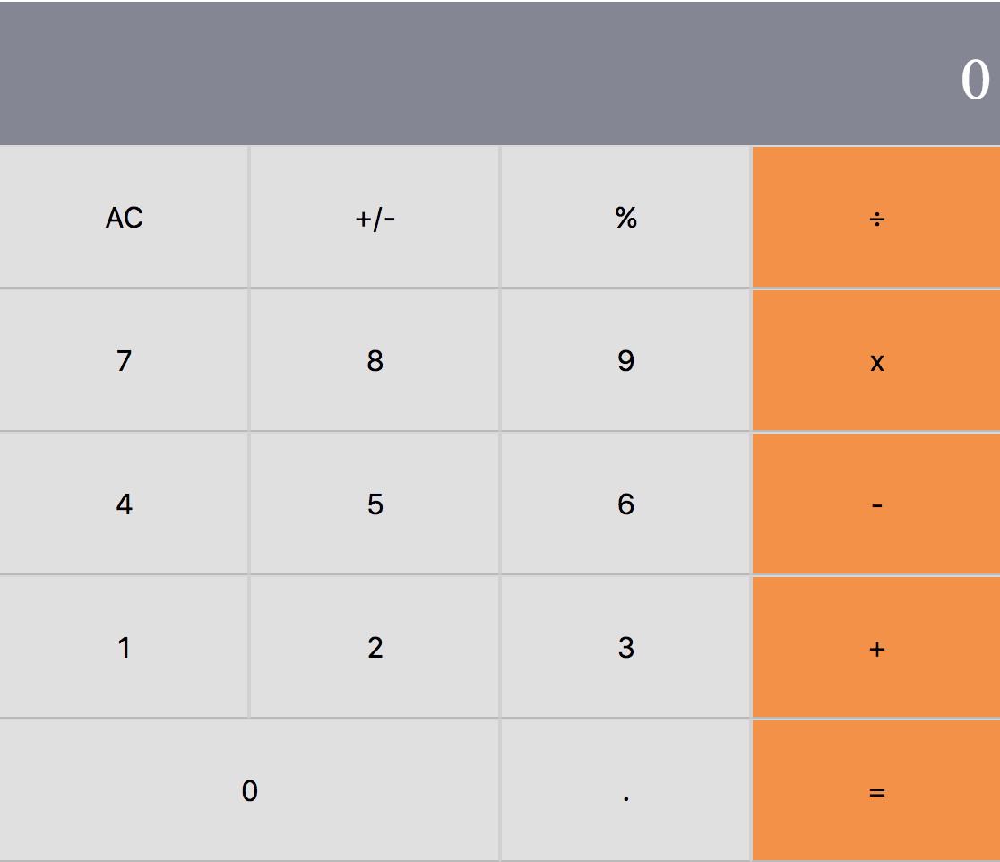

<br />
<h1 align="center">React Project - Calculator</h1>


## Table of Contents

* [About the Project](#about-the-project)
  * [Built With](#built-with)
* [Run This App](#run-this-app)
* [License](#license)
* [Contact](#contact)


## About The Project

The goal of this project is to build a calculator using React. The app was originally bootstrapped with Create React App and later migrated to **Vite** with **React 18** for a faster dev experience and up-to-date dependencies.



### Basic project structure

* Create a react app with create-react-app;
* Delete the unnecessary file and assets;
* Add the big.js;
* Verify if everything is ok;
* Deploy to Vercel (https://react-calculator-phi-five.vercel.app/).

### Create components

* Prepare the directory structure;
* Implement the App component;
* Implement the Display component;
* Implement the Button component;
* Implement the ButtonPanel component.

### Adding Styling

* Use grid display mode for App, Display and ButtonPanel component;
* Style the Display component;
* Style the ButtonPanel component;
* Style the Button component;
* Pass “color” and “wide” props to the Button.

### Calculations 

* Preparation;
* Implement the calculate.js module
* Implement the operate.js module
* Add calculate.js to the App component

### Event handlers 

* App component
* ButtonPanel
* Button

### Built With 

* Node.js (>= 18)
* React 18
* React-DOM
* Vite
* big.js
* npm
* CSS
* ES6
* ESLint 9

## Run This App

### Prerequisites

* Node.js 18 or newer
* npm

### Install dependencies

```bash
npm install
```

### Development

```bash
npm start
```

Opens the app at `http://localhost:5173`.

### Production build

```bash
npm run build
```

Build output is written to the `dist/` folder.

### Preview production build

```bash
npm run preview
```

### Lint

```bash
npm run lint
```

### Deploy (Vercel)

* **Build command:** `npm run build`
* **Output directory:** `dist`

Live demo: https://react-calculator-phi-five.vercel.app/

## License

Distributed under the MIT License. See `LICENSE` for more information.

## Contact
* Felipe Enne - felipeenne@gmail.com | [Github Account https://github.com/FelipeEnne](https://github.com/FelipeEnne)
